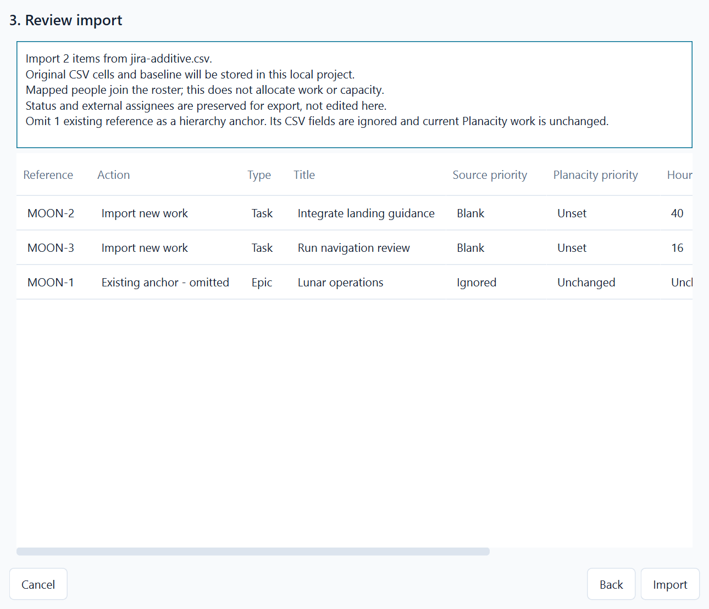
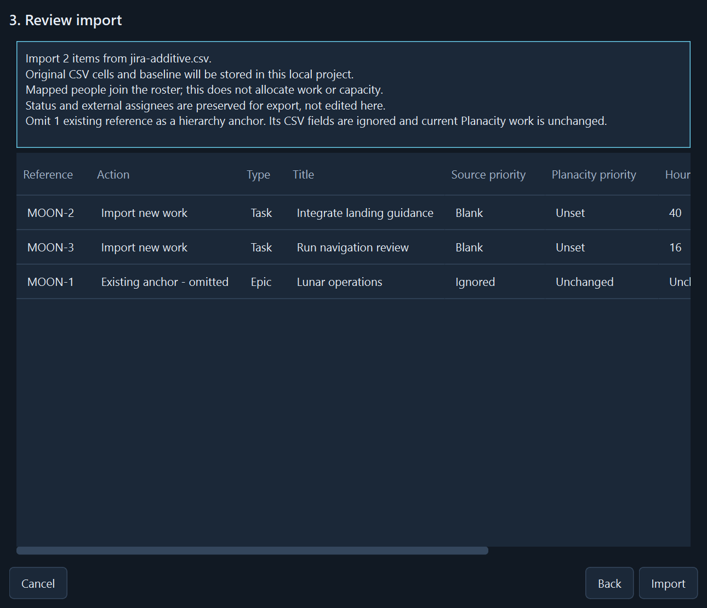
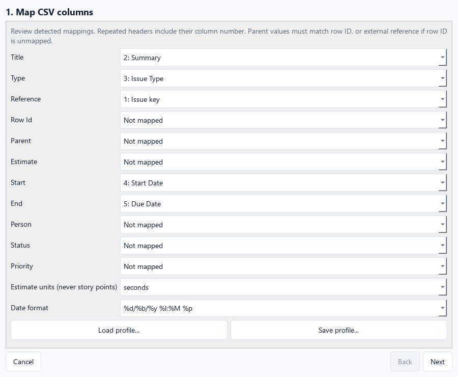
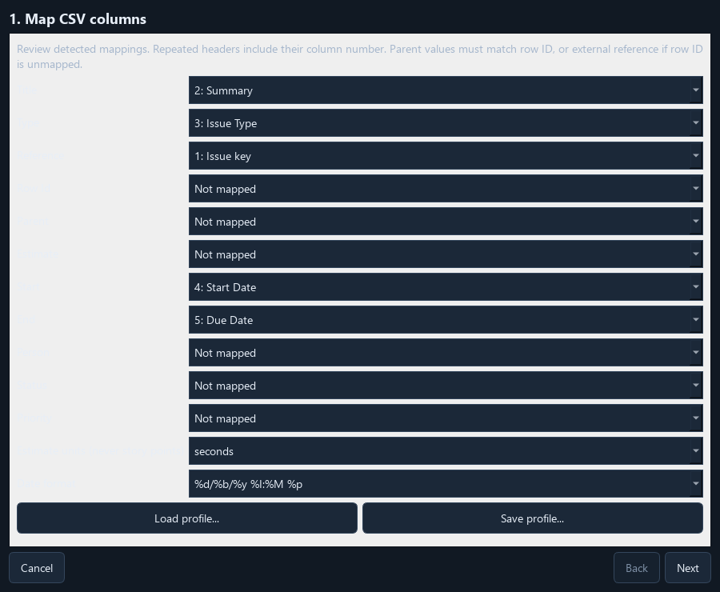
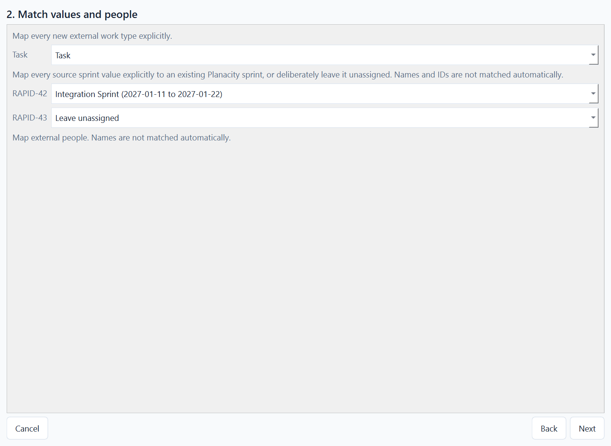
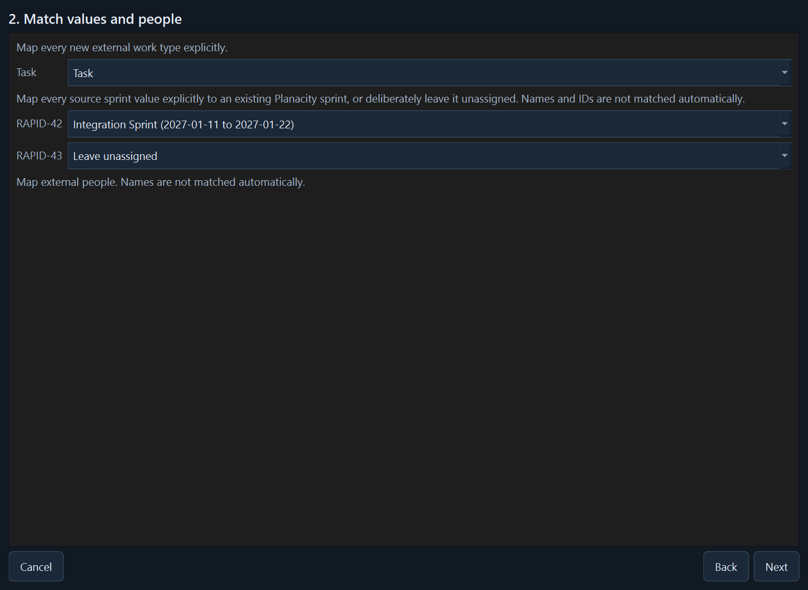
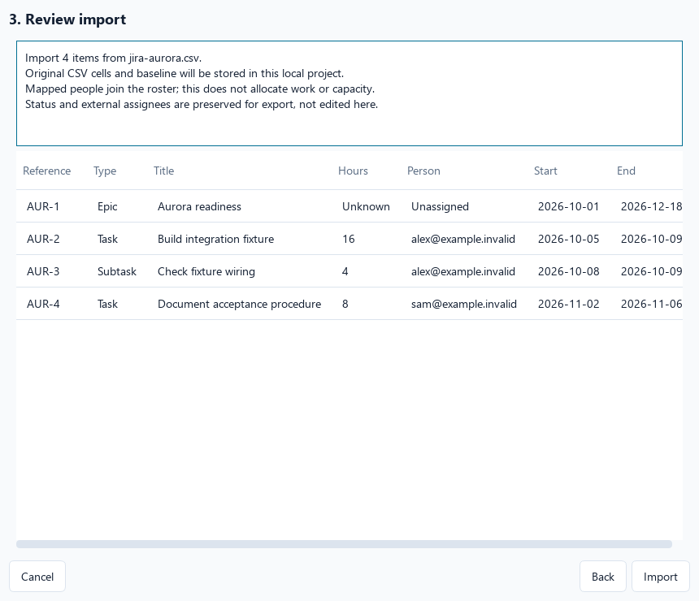
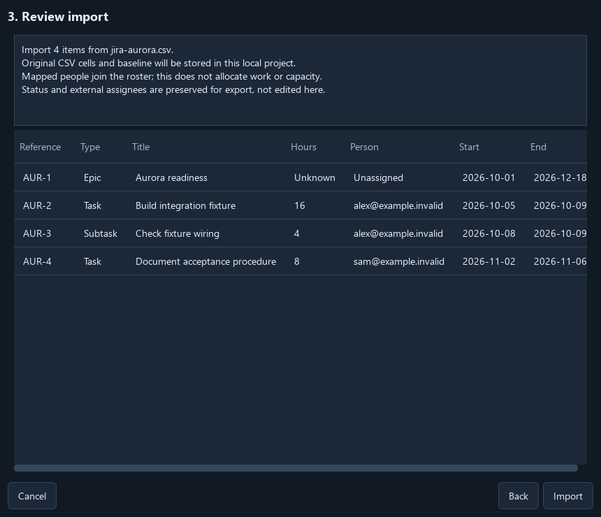
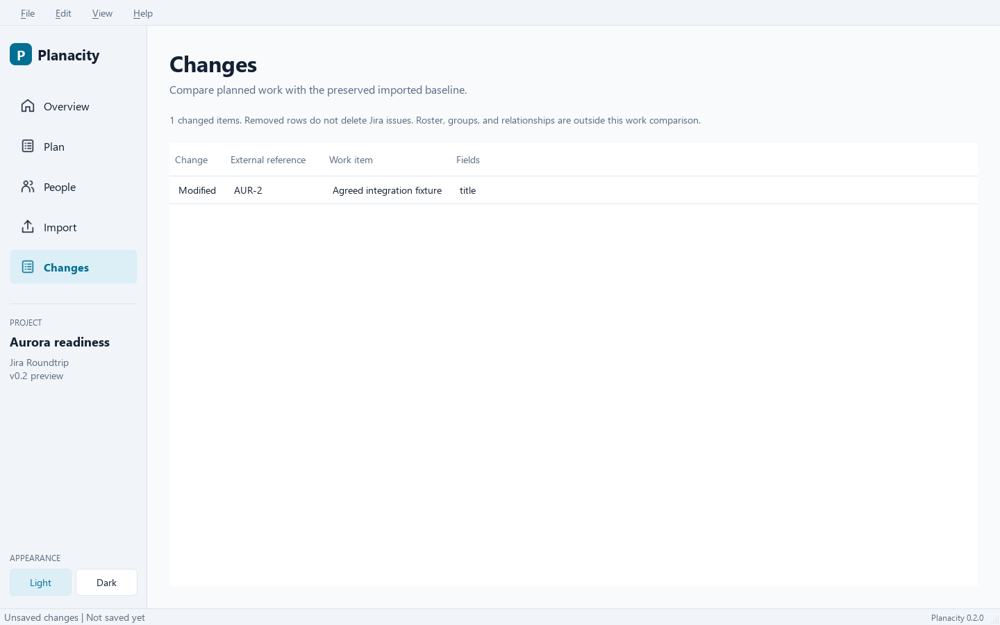
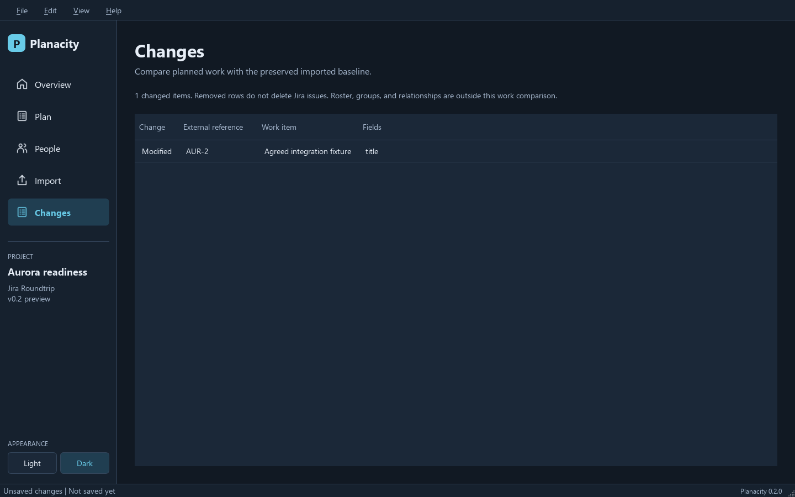

# Import Jira CSV

Create or open a Program Plan, then choose **Import -> Import Jira CSV...**.
Select the delimiter before choosing a UTF-8 file. UTF-8 BOMs, quoted commas,
multiline cells, and repeated column headers are supported. Other encodings
must be converted explicitly before import. No Jira credentials or network
connection are used.

1. Review the detected column mapping. Title, work type, and external reference
   are required. Columns are identified by position, including repeated headers.
   Map numeric issue IDs to **Row ID** when Parent contains those numbers.
   Otherwise, Parent must contain external references. Include all parent rows.
   In a Planacity hierarchical export, Work item ID values are temporary,
   export-local references and Parent points to those values. They are separate
   from genuine Jira issue keys. A flat Planacity export omits both columns.
2. Choose **seconds** or **hours** for estimates and the exact date format.
   Story points are not hours and are never converted automatically. Blank
   estimates remain unknown; zero remains zero. Dates outside the plan horizon
   are retained and flagged in the Plan view.
   Untouched Jira exports may use `%d/%b/%y %I:%M %p`, for example
   `12/Dec/25 12:00 AM`. Planacity validates the complete value with English
   month abbreviations and imports its calendar date. It does not store a time
   or perform timezone conversion. Blank dates remain unset.
3. Map every external type to Epic, Task, or Subtask. Unsupported types such as
   Story require an explicit choice; their original cells remain in the source.
   If Priority is mapped, review each distinct nonblank source value. Highest,
   High, Medium, Low, and Lowest receive case-insensitive default suggestions.
   Custom labels remain **Unmapped -> Unset** until you choose a canonical value.
   Blank and unresolved values never silently become Medium.
   Match each nonblank external person to a roster entry or explicitly create
   one. This sets the canonical work assignee in the current plan and preserved
   baseline. It does not create work allocations or capacity hours.
   If Sprint is mapped, review every distinct nonblank value from the new rows.
   Choose one existing Planacity sprint or deliberately choose **Leave
   unassigned**. Planacity does not match sprint names, external references,
   dates, hierarchy, or assignees automatically. Only executable leaf work can
   receive a sprint assignment; Epics and Tasks with imported children must
   remain unassigned. Blank cells require no choice.
4. Review the complete preview and choose **Import**. Errors keep the wizard open;
   Cancel leaves the document unchanged. Imported work is added to the active
   plan, which becomes unsaved until you save it.

Use `examples/jira-aurora.csv` for a fictional example. Map its two external
people to new or existing roster entries. Default units are seconds and its
dates use `%Y-%m-%d`.

## Profiles

Use **Save profile...** and **Load profile...** on the column-mapping page to
reuse a local JSON profile. After choosing custom type mappings, go Back to the
first page to save them. Priority value mappings follow the same workflow.
Profiles require the same headers in the same order;
they never silently adapt a changed CSV. They contain column names, positions,
type and priority-value mappings, units, date format, and the optional Sprint
column position, not CSV rows, person identities, source sprint values, or
plan-specific sprint IDs. Sprint choices are reviewed again for every import.
Version 1 profiles remain readable; newly saved version 2 profiles include
priority mappings.
Profiles with duplicate JSON fields are rejected rather than choosing one value.
Remove the duplicate fields or save a new profile from the wizard. A failed load
keeps the current mapping unchanged.

## Preserved baseline

The project stores original cell values, including unmapped fields, together
with original work items, external references, original status, original priority
text, and person mapping snapshots. The mapped canonical priority is stored on
the baseline WorkItem separately from that source text. Editing or removing local
work does not rewrite either value. The exact external assignee text is also
retained independently from the roster display name.
JSON backups retain it too. Keep these files local if the imported data is
sensitive. Baseline person names remain even if a roster entry is later removed.

New CSV sources may add work while also containing references already present in
the plan. Review marks those rows as **Existing anchor - omitted**. Planacity
ignores every field from the repeated row and leaves the current work and its
original baseline unchanged. The stable existing identity may still resolve a
new child's Parent. When Parent uses a numeric Row ID, include the existing
parent row so its temporary ID can be resolved. When Parent contains external
references, an existing parent does not need to be repeated in the CSV.

Only genuinely new rows are stored in the new source snapshot; the review states
which anchor rows are intentionally omitted. An anchor whose current WorkItem
was deleted blocks the import rather than restoring or guessing it. A file with
no new references also remains blocked. Updating existing Jira work, comparing
Jira-side changes, and resolving conflicts still belong to the explicit v0.8
reconciliation workflow tracked by issue #139. Unknown parents, invalid
hierarchy, dates, estimates, and duplicate references within one CSV block the
complete import.

Sprint mapping follows the same additive boundary. A repeated-reference anchor's
Sprint cell is ignored together with its other cells, so its current Planacity
sprint assignment is never changed. Only new rows contribute source sprint values
to the mapping page and only their canonical leaf work can receive new
SprintAssignment records. The original source cell remains in the immutable raw
snapshot. Jira sprint export, automatic sprint creation, and synchronization are
not part of this workflow.

## Imported work in Plan

Plan derives imported provenance from stable WorkItem IDs preserved in all
source snapshots. A current row with a baseline uses a subtle theme-aware amber
tint and an import icon beside its title. The tooltip and accessible description
explain that the work remains editable and is neither read-only nor synchronized
with its source. Local edits retain the cue because identity, not title, drives
it. Manually created work is unchanged, and a removed current item does not
produce a baseline-only row.

This is a provenance cue, not Jira reconciliation. Changes still compares the
current item with its immutable baseline, while Jira updates remain the explicit
future workflow tracked by issue #139.

Seconds are converted to decimal hours with Python's default 28 significant
digit precision. Original CSV values remain available in the baseline; exports
restore integral seconds when the difference is only division roundoff.

## Changes

**Changes** (Ctrl+5) lists added, modified, and removed work against all imported
work snapshots. It compares title, type, parent, estimate, dates, priority, and
canonical assignee. Work with no imported snapshot appears as Added once a
baseline exists. Roster changes, WorkGroups, and relationships are outside this
comparison. Status and exact external assignee text remain preserved provenance.

## Validation record

The P02 checks cover all canonical levels, exact default suggestions, custom and
repeated values, blanks, visible unresolved values, import profile v1/v2
compatibility, reusable export profiles, CSV escaping, priority Changes,
schema 1-9 migration, and baseline-preserving export. The complete suite passes
756 tests; three focused dialogs also pass with Qt's native Windows plugin.
Ruff, mypy, and source/wheel builds pass. Both appearances were captured from the
real Qt mapping and export dialogs with fictional data.

The Windows/Python 3.12/PySide6 6.11.2 checks cover import mapping and correction,
preview cancellation, explicit type and people mapping, profile reuse, the real
import/export dialogs, baseline preservation after edits and save/reopen, and
protection of the active project during export. Native Windows acceptance passed
20 UI tests spanning the roundtrip and existing manual planning workflows.
The full automated suite passed 197 tests. Website and package builds passed.
GitHub CI also checks Windows and Linux with Python 3.11 and 3.13.

Real screenshots using only the fictional example:

